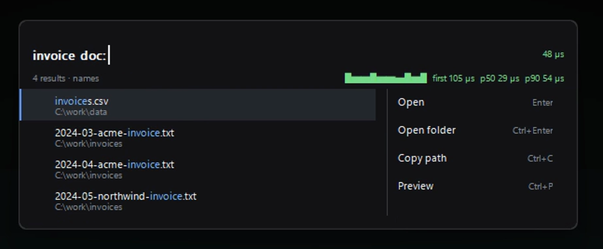
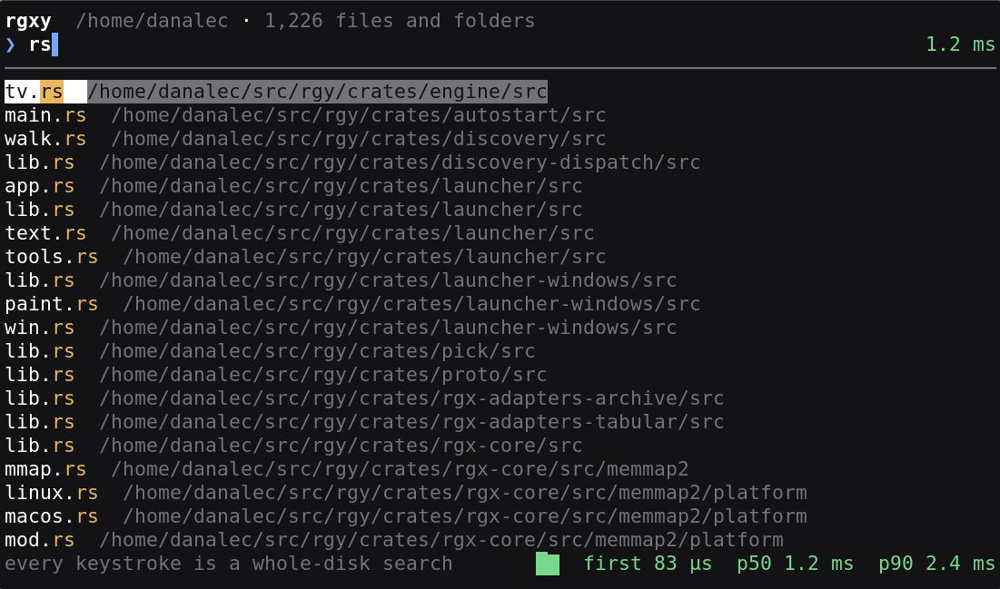

# rgy

Whole-filesystem name search and content search in one stack. It indexes the
names on your disks once, then answers **which file?** and **what is inside
it?** in a single query, with rgx's content engine underneath.

[](https://www.youtube.com/watch?v=bLDYOjMUQGs)

```sh
searchctl --root ~ "invoice ext:pdf"      # which file
searchctl --root ~ "invoice grep:tesla"   # and what is inside it
```

## See it work

Two faces, one daemon. Click either one to watch it move.

[](docs/videos/gui-filters.mp4)

[](docs/videos/term-tui.mp4)

## Install

The current release is **0.1.10.0**; the crates are at **0.1.10** (the
registry takes three numbers, the release tag carries a fourth). The
[release page](docs/release-0.1.10.0.md) is the changelog.

**One line** installs the tool, the daemon and the launcher:

```sh
# Windows
irm https://raw.githubusercontent.com/danalec/rgy/main/install.ps1 | iex

# Linux, macOS and FreeBSD
curl -fsSL https://raw.githubusercontent.com/danalec/rgy/main/install.sh | bash
```

The installer picks the archive for your machine, verifies its SHA256 against
a digest pinned in the installer, unpacks the binaries into `~/.local/bin`
(or `%LOCALAPPDATA%\Programs\rgy` on Windows), adds that directory to your
PATH, and registers the daemon to start at login. Add `--uninstall` (or
`-Uninstall` on Windows) to take all of that back out. Nothing is elevated
and nothing asks: the entry goes into your own session.

**From a package manager:**

| platform | manager | command |
|---|---|---|
| Windows | [Scoop](https://scoop.sh/) | `scoop bucket add danalec_scoop-alts https://github.com/danalec/scoop-alts` · `scoop install danalec_scoop-alts/rgy` |
| Arch Linux | [AUR](https://aur.archlinux.org/packages/rgy-search-bin) | `yay -S rgy-search-bin` |
| any | crates.io | `cargo install rgy-search --version 0.1.10` |

The AUR has three binary packages — `rgy-search-bin` (portable),
`rgy-search-avx2-bin` (AVX2) and `rgy-search-znver4-bin` (AMD Zen 4). They
conflict, because all three install `/usr/bin/searchctl`: pick one.

Two more manifests live in this repository but are not published as packages
yet: `.winget/` (submission
[#474460](https://github.com/microsoft/winget-pkgs/pull/474460) awaiting a
moderator) and `Formula/rgy-search.rb` (tap not published). `winget install
danalec.rgy-search` and `brew install danalec/rgy/rgy-search` install
nothing today. The [manual](MANUAL.md#the-packages) says the state of each
one plainly.

**From the release** — the archive carries the binaries, the `rgy` alias and
the documents, and needs neither Rust nor a compiler:

| platform | archive |
|---|---|
| Windows x86_64 | `rgy-v0.1.10.0-x86_64-windows.zip` |
| Linux x86_64 | `rgy-v0.1.10.0-x86_64-linux.tar.gz` |
| FreeBSD x86_64 | `rgy-v0.1.10.0-x86_64-freebsd.tar.gz` |

The release carries twelve archives in all — portable, AVX2 and Zen 4 builds
for Windows and Linux x86_64, aarch64 Windows and Linux, static musl,
FreeBSD, and both macOS architectures — beside a `SHA256SUMS`. Each is built
and smoked on the runner that has that platform. `install.sh` picks the
FreeBSD channel from `uname -s` by itself; there is no login item there yet.

## Your first five minutes

Point it at a folder and give it a query in quotes:

```sh
searchctl --root ~ "invoice"
```

The first run walks the tree and builds an index of the names; later runs
reuse it for **30 minutes** (`--max-age` moves that window). Progress goes to
stderr, so it never pollutes output you pipe. The index lives in the platform
cache folder; `RGY_INDEX_DIR` moves its base.

A query is a list of words and **every word narrows the answer**:

| you write | rgy looks for |
|---|---|
| `invoice` | anything close to "invoice" — a typo still hits |
| `'invoice`, `^invoice`, `invoice$`, `=invoice` | contains / starts / ends / whole word |
| `"invoice pdf"` | contains the phrase, space and all |
| `!invoice` | anything **not** close to "invoice" |

Filters narrow by a property: `ext:`, `type:`, `size:`, `dir:`, `in:`,
`mtime:`, `re:`, `limit:`, `sort:`. Three operators look **inside** the file
with `path:line:text` output: `grep:` (literal), `regex:`, `sym:`.
`report|invoice` means "or", and a term with `*` or `?` globs the whole path.

An unknown `type:` fails closed: a warning on stderr, zero matches, exit 1.
Exit codes: **0** found something, **1** nothing matched, **2** the run
failed.

```sh
searchctl --root ~ "invoice" --count        # how many hits
searchctl --root ~ "invoice" --json         # one JSON object per hit
searchctl --root ~ "invoice" --limit 100    # more than the 50 default
```

The [manual](MANUAL.md) has the whole query language, every flag, the daemon
protocol and the pack store; [FORMATS.md](FORMATS.md) has what it reads
inside a file.

## The binaries

| binary | what it does |
|---|---|
| `searchctl` | the command-line tool — the one you type |
| `searchd` | the daemon: keeps the index warm between queries |
| `rgxy` | the launcher: a floating window on Windows, the terminal interface on Linux, macOS and FreeBSD |
| `rgy-autostart` | puts the daemon in place at login, and takes it out again |
| `rgy` | another name for `searchctl` — the same binary |

`searchctl` alone is enough for hand-typed queries: it walks the tree each
time, so it sees files created while the machine was off. The daemon is for
scripts and repeated searches; `rgxy` is its client, so the window is there
in milliseconds — it is asking an index that is already built.

```sh
searchd --root ~                                        # JSON requests, one per line
rgy-autostart install      # the daemon beside the tool, indexing your home
rgy-autostart status       # what is registered
rgy-autostart doctor       # what is registered, whether it is up, and what to do
rgy-autostart uninstall    # take it out
rgxy --query invoice       # one search, printed, and out
rgxy --tui                 # the terminal interface
```

Nothing is registered in the administrator's account: the entry goes into
your own session — a Task Scheduler task or `HKCU` run value on Windows, a
systemd **user** unit on Linux, a launchd agent on macOS. Running the command
*is* the consent; no dialog, no elevation.

Nothing else: no runtime, no service, nothing to configure. The parts that
differ per operating system (the Windows MFT walk, the Linux change feed, the
macOS FSEvents feed, the FreeBSD `getdirentries` walk) are compiled in and
chosen by `cfg` at build time.

## rgy or rgx?

[rgx](https://github.com/danalec/rgx) is the content-search specialist: an
`rg` replacement that reads *inside* files — PDFs, Office documents,
archives, mail, media metadata, 3D models, LLM checkpoints — with `rg`'s
flags, output and exit codes. The `rgx-*` crates in this workspace are its
engine and adapters, transported verbatim.

| | rgy | rgx |
|---|---|---|
| Which file, anywhere on the disk | ✅ name index, ranked, typo-tolerant, live overlay | walk + path globs |
| What is inside it | ✅ `grep:` / `regex:` / `sym:` | ✅ rg patterns |
| Name and content in one query | ✅ `report ext:pdf grep:tesla` | pattern + globs |
| Drop-in `rg` (flags, output, exit codes) | exit codes only | ✅ |
| Persistent index across runs | ✅ `--index`, `--max-age` | walk per run (pack store opt-in) |

**Take rgx** if you think in `rg` flags and regexes, script against `--json`
submatches, or triage binaries. **Take rgy** if you want both everyday
questions over the whole filesystem in one plain query language, with one
daemon underneath and nothing to configure.

## Build from source

Rust **1.89** or newer, and a C compiler for the allocator. The workspace
mixes editions on purpose: rgy's crates are edition 2024, the vendored rgx
crates stay on 2021 so they diff cleanly against upstream.

```sh
cargo build --release
cargo run --release -p rgy-search -- --root crates "walk ext:rs grep:Listing"
cargo test --workspace --no-fail-fast
```

Build before you test: the e2e harness resolves the binaries by path. The
perf gate fails a PR on a >20% regression against
[`benchmark/baseline-names.md`](benchmark/baseline-names.md); the write-ups
carry the host and date on every number.

## License

Apache-2.0 for the product and the end-to-end harness, MIT OR Apache-2.0 for
the tooling around it — the full map is in `COPYING`, with texts in
`LICENSE-APACHE` and `LICENSE-MIT` and third-party notices in `NOTICE`.
Every file carries its `SPDX-License-Identifier:` header.

## Related projects

| Project | Repo | What it provides |
|---|---|---|
| `rgx` | [github.com/danalec/rgx](https://github.com/danalec/rgx) | content search engine, adapters, Tesla Valve packs |

## Star history

<a href="https://star-history.com/#danalec/rgy&Date">

<picture>
<source media="(prefers-color-scheme: dark)" srcset="https://api.star-history.com/svg?repos=danalec/rgy&type=Date&theme=dark">
<source media="(prefers-color-scheme: light)" srcset="https://api.star-history.com/svg?repos=danalec/rgy&type=Date">

</picture>
</a>
