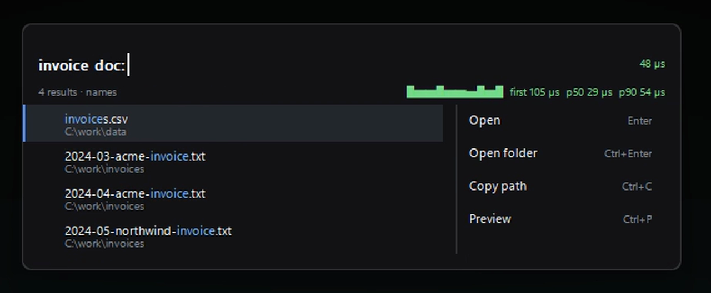
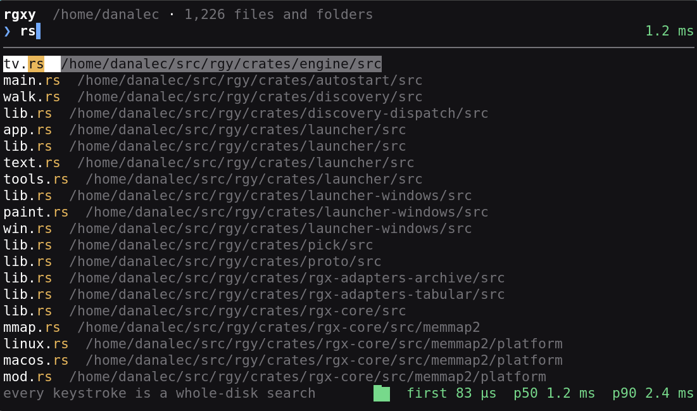

# rgy

Whole-filesystem name search and content search in one stack. It indexes the
names on your disks once, then answers **which file?** and **what is inside
it?** in a single query, with rgx's content engine underneath.

[](https://www.youtube.com/watch?v=bLDYOjMUQGs)

```sh
searchctl --root ~ "invoice ext:pdf"      # which file
searchctl --root ~ "invoice grep:tesla"   # and what is inside it
```

## See it work

Two faces, one daemon. Click either one to watch it move.

[](docs/videos/gui-filters.mp4)

[](docs/videos/term-tui.mp4)

## Install

The current release is **0.1.10.2**; the crates are at **0.1.10** (the
registry takes three numbers, the release tag carries a fourth). The
[release page](docs/release-0.1.10.2.md) is the changelog.

**One line** installs the tool, the daemon and the launcher:

```sh
# Windows
irm https://raw.githubusercontent.com/danalec/rgy/main/install.ps1 | iex

# Linux, macOS and FreeBSD
curl -fsSL https://raw.githubusercontent.com/danalec/rgy/main/install.sh | bash
```

The installer picks the archive for your machine, verifies its SHA256 against
a digest pinned in the installer, unpacks the binaries into `~/.local/bin`
(or `%LOCALAPPDATA%\Programs\rgy` on Windows), adds that directory to your
PATH, and registers the daemon to start at login. Add `--uninstall` (or
`-Uninstall` on Windows) to take all of that back out. Nothing is elevated
and nothing asks: the entry goes into your own session.

**From a package manager:**

| platform | manager | command |
|---|---|---|
| Windows | [Scoop](https://scoop.sh/) | `scoop bucket add danalec_scoop-alts https://github.com/danalec/scoop-alts` · `scoop install danalec_scoop-alts/rgy` |
| Arch Linux | [AUR](https://aur.archlinux.org/packages/rgy-search-bin) | `yay -S rgy-search-bin` |
| any | crates.io | `cargo install rgy-search --version 0.1.10` |

The AUR has three binary packages — `rgy-search-bin` (portable),
`rgy-search-avx2-bin` (AVX2) and `rgy-search-znver4-bin` (AMD Zen 4). They
conflict, because all three install `/usr/bin/searchctl`: pick one.

Two more manifests live in this repository but are not published as packages
yet: `.winget/` (submission
[#474460](https://github.com/microsoft/winget-pkgs/pull/474460) awaiting a
moderator) and `Formula/rgy-search.rb` (tap not published). `winget install
danalec.rgy-search` and `brew install danalec/rgy/rgy-search` install
nothing today. The [manual](MANUAL.md#the-packages) says the state of each
one plainly.

**From the release** — the archive carries the binaries, the `rgy` alias and
the documents, and needs neither Rust nor a compiler:

| platform | archive |
|---|---|
| Windows x86_64 | `rgy-v0.1.10.2-x86_64-windows.zip` |
| Linux x86_64 | `rgy-v0.1.10.2-x86_64-linux.tar.gz` |
| FreeBSD x86_64 | `rgy-v0.1.10.2-x86_64-freebsd.tar.gz` |

The release carries twelve archives in all — portable, AVX2 and Zen 4 builds
for Windows and Linux x86_64, aarch64 Windows and Linux, static musl,
FreeBSD, and both macOS architectures — beside a `SHA256SUMS`. Each is built
and smoked on the runner that has that platform. `install.sh` picks the
FreeBSD channel from `uname -s` by itself; there is no login item there yet.

## Your first five minutes

Point it at a folder and give it a query in quotes:

```sh
searchctl --root ~ "invoice"
```

The first run walks the tree and builds an index of the names; later runs
reuse it for **30 minutes** (`--max-age` moves that window). Progress goes to
stderr, so it never pollutes output you pipe. The index lives in the platform
cache folder; `RGY_INDEX_DIR` moves its base.

A query is a list of words and **every word narrows the answer**:

| you write | rgy looks for |
|---|---|
| `invoice` | anything close to "invoice" — a typo still hits |
| `'invoice`, `^invoice`, `invoice$`, `=invoice` | contains / starts / ends / whole word |
| `"invoice pdf"` | contains the phrase, space and all |
| `!invoice` | anything **not** close to "invoice" |

Filters narrow by a property: `ext:`, `type:`, `size:`, `dir:`, `in:`,
`mtime:`, `re:`, `limit:`, `sort:`. Three operators look **inside** the file
with `path:line:text` output: `grep:` (literal), `regex:`, `sym:`.
`report|invoice` means "or", and a term with `*` or `?` globs the whole path.

An unknown `type:` fails closed: a warning on stderr, zero matches, exit 1.
Exit codes: **0** found something, **1** nothing matched, **2** the run
failed.

```sh
searchctl --root ~ "invoice" --count        # how many hits
searchctl --root ~ "invoice" --json         # one JSON object per hit
searchctl --root ~ "invoice" --limit 100    # more than the 50 default
```

The [manual](MANUAL.md) has the whole query language, every flag, the daemon
protocol and the pack store; [FORMATS.md](FORMATS.md) has what it reads
inside a file.

## The binaries

| binary | what it does |
|---|---|
| `searchctl` | the command-line tool — the one you type |
| `searchd` | the daemon: keeps the index warm between queries |
| `rgxy` | the launcher: a floating window on Windows, Linux and FreeBSD, the terminal interface on macOS |
| `rgy-autostart` | puts the daemon in place at login, and takes it out again |
| `rgy` | another name for `searchctl` — the same binary |

`searchctl` alone is enough for hand-typed queries: it walks the tree each
time, so it sees files created while the machine was off. The daemon is for
scripts and repeated searches; `rgxy` is its client, so the window is there
in milliseconds — it is asking an index that is already built.

```sh
searchd --root ~                                        # JSON requests, one per line
rgy-autostart install      # the daemon beside the tool, indexing your home
rgy-autostart status       # what is registered
rgy-autostart doctor       # what is registered, whether it is up, and what to do
rgy-autostart uninstall    # take it out
rgxy --query invoice       # one search, printed, and out
rgxy --tui                 # the terminal interface
```

**The window opens with Alt+Space.** That is the default global shortcut on
Windows, Linux and FreeBSD: one registered chord, not a double tap of a lone
modifier. On Linux and FreeBSD it is a passive `XGrabKey` of `Mod1Mask` +
`XK_space`; on Windows it is `RegisterHotKey(MOD_ALT, VK_SPACE)`. It works
while the window is hidden, and grabbed keys are replayed so Alt+Space still
reaches the window manager. The tray icon also opens it. `rgxy --no-hook`
runs without the global shortcut. On desktops whose window manager already
takes Alt+Space for the window menu, the grab is refused (`BadAccess`) and
the launcher says so; set another shortcut in `settings.tsv` there.

The settings panel (`>settings`, or the tray) can change the shortcut to a
double tap of Control/Alt/Shift or to another combo; the file spells it as
`combo alt+space`, `double ctrl 400`, and so on. Inside the window:
`Ctrl+K` opens the actions menu, `Ctrl+P` previews a file, `Ctrl+Enter`
opens its folder, `Ctrl+C` copies its path, `>settings` opens the panel.

Nothing is registered in the administrator's account: the entry goes into
your own session — a Task Scheduler task or `HKCU` run value on Windows, a
systemd **user** unit on Linux, a launchd agent on macOS. Running the command
*is* the consent; no dialog, no elevation.

Nothing else: no runtime, no service, nothing to configure. The parts that
differ per operating system (the Windows MFT walk, the Linux change feed, the
macOS FSEvents feed, the FreeBSD `getdirentries` walk) are compiled in and
chosen by `cfg` at build time.

## The index, and how it stays fresh

**`searchctl` is not a systemd service, has nothing to do with systemd, and
does not require systemd.** Despite the name, it is an ordinary command-line
program: you run it, it walks the tree you name with `--root`, and it exits.
The `searchd` daemon is a *separate, optional* binary. `rgy-autostart` uses
systemd **user** units on Linux only as one convenient way to start that
daemon at login; on Windows it uses Task Scheduler or the `HKCU` run value,
on macOS launchd, and on FreeBSD there is no login item at all. Nothing in
rgy is installed into, or depends on, the system init — you can use rgy on a
machine with no systemd, with systemd disabled, or with no init at all.

`searchctl` reads a name index it keeps in the platform cache folder, keyed by
the tree you point `--root` at. There are **two ways to keep that index
fresh** — pick one, because both write the same file:

| | daemon | one-shot + schedule |
|---|---|---|
| Process | resident `searchd`, started at login | none; one `searchctl` run at a time |
| Freshness | a live change feed (inotify / USN journal / FSEvents): changes land as they happen | a snapshot, rebuilt whenever you run the command |
| Queries | always warm | reuse the snapshot for 30 minutes (`--max-age`), then rebuild on demand |
| Setup | `rgy-autostart install`; after the fact, `install.sh --activate` / `install.ps1 -Activate` | `searchctl --root ~ --reindex --count '*'`, then schedule it |

**Recreate the index and pick up new, changed and deleted files in one
command** — rgy's equivalent of `updatedb`:

```sh
searchctl --root ~ --reindex --count '*'
```

`--reindex` forces a full walk even when a usable snapshot exists, `'*'` is a
whole-path glob matching every entry (a query is required), and `--count`
prints one number instead of every hit. A later plain query reuses that
snapshot for 30 minutes; `--max-age 0` means *never reuse*, so every query
rebuilds it. The one-line installer activates the daemon for you; a package
manager (Scoop, AUR, an extracted archive, crates.io) does **not**, and its
post-install message offers these same two commands.

**If you did nothing after a package-manager install, be precise about what
needs what:**

- **`searchctl` needs an index, not a daemon.** It builds one on the first
  query (or on the one-shot command above) and answers without any service.
  Rebuilding it at least once is what makes searches fast; the result can be
  up to 30 minutes stale until the next rebuild.
- **`rgxy` needs a *running* `searchd`, not an index.** It is a client of the
  daemon over a socket or named pipe. Merely indexing once does **not** make
  `rgxy` work — with no daemon it says `no connection to the daemon`.

To install and configure the daemon, run `rgy-autostart install` (or
`install.sh --activate` / `install.ps1 -Activate` after the fact);
`rgy-autostart doctor` reports what is registered and whether it is up.

**One platform detail:** `rgy-autostart install` starts the daemon
immediately on Linux (`systemctl --user enable --now`) and macOS
(`launchctl bootstrap`), but on Windows it only registers a **logon** task —
the daemon starts at your *next* login, not in the current session. The
Windows installer (`install.ps1 -Activate`, and the end of a normal
`install.ps1` install) runs `schtasks /Run /TN rgy-searchd` right after
registering, so the daemon is up now too. If you register by hand on
Windows, `rgy-autostart doctor` prints that same `fix:` command.

**Wondering what the daemon has indexed?** It prints `walking the tree`,
`scanning… <dirs> dirs, <entries> entries` every 500 ms and then
`indexed N entries → <path>` to stderr while it starts. Once it is up,
`rgy-autostart doctor` tells you whether it is running, and sending
`{"op":"status"}` to its socket returns
`{"op":"status","docs":N,"event_id":…,"catch_up":"relisted","tv":false,"feed":"live"}` —
`docs` is the live entry count, `catch_up` says whether it replayed a change
journal or walked the tree again, and `feed` says whether the tree is still
being followed (`live` / `gone` / `none`). [The manual](MANUAL.md#watching-the-index-being-built-and-asking-its-state)
has the exact commands and every field.

**To try `rgxy` without installing anything**, start a daemon in the
foreground — no systemd, no login entry, nothing registered — and point the
launcher at it. Stop it with Ctrl-C when you are done:

```sh
# Linux, macOS, FreeBSD
searchd --root ~ --listen uds:/tmp/rgy-try.sock &
rgxy --endpoint uds:/tmp/rgy-try.sock --query invoice
```

```powershell
# Windows
Start-Process searchd.exe -ArgumentList '--root', $env:USERPROFILE, '--listen', 'pipe:rgy-try'
rgxy.exe --endpoint pipe:rgy-try --query invoice
```

Or, for a single question with no daemon at all, use `searchctl` directly:
`searchctl --root ~ "invoice"`. The [manual](MANUAL.md) has the full picture.

### Compared with `locate` / `updatedb`

`locate` answers from a static database that `updatedb` rebuilds on a
schedule (traditionally a daily cron job); a file created after the last
`updatedb` is invisible until the next run. rgy's one-shot mode is exactly
that model: `searchctl --reindex` is `updatedb`, a daily timer is the cron
job, and `searchctl <query>` is `locate`. rgy's daemon mode is the other
answer — a resident `updatedb` that never sleeps, applying changes
continuously, so no schedule is needed.

| | `locate` / `updatedb` | rgy |
|---|---|---|
| Match | path substring / glob | typo-tolerant fuzzy, plus exact (`'x`, `^x`, `x$`, `=x`), phrase, negation (`!x`), OR (alternatives with a pipe) and whole-path globs |
| Filters | none | `ext:` `type:` `size:` `dir:` `in:` `mtime:` `re:` `limit:` `sort:` |
| Inside the file | never | `grep:` `regex:` `sym:` with `path:line:text` output |
| Ranking | none | ranked results |
| Privileges | `updatedb` usually needs root to walk the whole disk | per-user, no root: you choose the tree with `--root`; the daemon is a systemd **user** unit |
| Freshness | next scheduled `updatedb` | live (daemon) or on demand (one-shot) |

`locate` is a fine, tiny tool for "find a path by substring". rgy is for when
you also want typo tolerance, filters, content search and ranked results over
a tree you chose.

### Once a day with systemd, without the daemon

On Linux, `rgy-autostart install` is itself the systemd integration **for the
daemon**: it writes a **user** unit `rgy-searchd.service` and arms it with
`enable --now`. If you prefer the snapshot model instead, write a oneshot
service and a timer in the same user-unit directory:

```ini
# ~/.config/systemd/user/rgy-index.service
[Unit]
Description=Rebuild the rgy name index once
[Service]
Type=oneshot
ExecStart=%h/.local/bin/searchctl --root %h --reindex --count '*'
```

```ini
# ~/.config/systemd/user/rgy-index.timer
[Unit]
Description=Daily rgy index refresh
[Timer]
OnCalendar=daily
Persistent=true
[Install]
WantedBy=timers.target
```

```sh
systemctl --user daemon-reload
systemctl --user enable --now rgy-index.timer
```

`Persistent=true` runs a missed rebuild at the next boot. Use `/usr/bin/searchctl`
in `ExecStart` when a package manager put the binary there. **Do not run this
timer and the daemon on the same tree**: both write one index file, and a
scheduled `--reindex` would overwrite the daemon's live state. [The
manual](MANUAL.md#without-the-daemon-a-daily-index-refresh) has the full
recipe, a cron and Task Scheduler equivalent, and the unit that
`rgy-autostart` writes.

## rgy or rgx?

[rgx](https://github.com/danalec/rgx) is the content-search specialist: an
`rg` replacement that reads *inside* files — PDFs, Office documents,
archives, mail, media metadata, 3D models, LLM checkpoints — with `rg`'s
flags, output and exit codes. The `rgx-*` crates in this workspace are its
engine and adapters, transported verbatim.

| | rgy | rgx |
|---|---|---|
| Which file, anywhere on the disk | ✅ name index, ranked, typo-tolerant, live overlay | walk + path globs |
| What is inside it | ✅ `grep:` / `regex:` / `sym:` | ✅ rg patterns |
| Name and content in one query | ✅ `report ext:pdf grep:tesla` | pattern + globs |
| Drop-in `rg` (flags, output, exit codes) | exit codes only | ✅ |
| Persistent index across runs | ✅ `--index`, `--max-age` | walk per run (pack store opt-in) |

**Take rgx** if you think in `rg` flags and regexes, script against `--json`
submatches, or triage binaries. **Take rgy** if you want both everyday
questions over the whole filesystem in one plain query language, with one
daemon underneath and nothing to configure.

## Build from source

Rust **1.89** or newer, and a C compiler for the allocator. The workspace
mixes editions on purpose: rgy's crates are edition 2024, the vendored rgx
crates stay on 2021 so they diff cleanly against upstream.

```sh
cargo build --release
cargo run --release -p rgy-search -- --root crates "walk ext:rs grep:Listing"
cargo test --workspace --no-fail-fast
```

Build before you test: the e2e harness resolves the binaries by path. The
perf gate fails a PR on a >20% regression against
[`benchmark/baseline-names.md`](benchmark/baseline-names.md); the write-ups
carry the host and date on every number.

## License

Apache-2.0 for the product and the end-to-end harness, MIT OR Apache-2.0 for
the tooling around it — the full map is in `COPYING`, with texts in
`LICENSE-APACHE` and `LICENSE-MIT` and third-party notices in `NOTICE`.
Every file carries its `SPDX-License-Identifier:` header.

## Related projects

| Project | Repo | What it provides |
|---|---|---|
| `rgx` | [github.com/danalec/rgx](https://github.com/danalec/rgx) | content search engine, adapters, Tesla Valve packs |

## Star history

<a href="https://star-history.com/#danalec/rgy&Date">

<picture>
<source media="(prefers-color-scheme: dark)" srcset="https://api.star-history.com/svg?repos=danalec/rgy&type=Date&theme=dark">
<source media="(prefers-color-scheme: light)" srcset="https://api.star-history.com/svg?repos=danalec/rgy&type=Date">

</picture>
</a>
